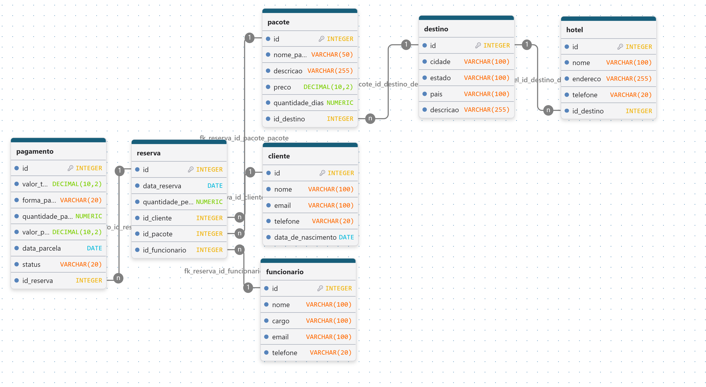

# Documento de requisitos do projeto

Nome do projeto: Agência de Viagens

Equipe de desenvolvimento: Laura Beatriz, Mayara Caetano, Sophia Nader

## Visão Geral do Sistema (Escopo)

O objetivo do projeto é desenvolver um sistema para gerenciamento de uma agência de viagens, permitindo o cadastro e a organização de informações sobre clientes, funcionários, destinos, hotéis, pacotes de viagens, reservas e pagamentos, proporcionando uma forma simples e eficiente de administrar os dados da agência.

## Requisitos Funcionais (RF)

RF01- Cadastro de clientes - O sistema deve permitir o cadastro de clientes, contendo as seguintes informações:

Nome;
E-mail;
Telefone;
Data de nascimento.

RF02- Cadastro de funcionários - O sistema deve permitir o cadastro de funcionários, contendo as seguintes informações:

Nome;
Cargo;
E-mail;
Telefone.

RF03- Cadastro de destinos - O sistema deve permitir o cadastro de destinos turísticos, contendo as seguintes informações:

Cidade;
Estado;
País;
Descrição.

RF04- Cadastro de hotéis - O sistema deve permitir o cadastro de hotéis relacionados aos destinos, contendo as seguintes informações:

Nome do hotel;
Endereço;
Telefone;
Destino.

RF05- Cadastro de pacotes - O sistema deve permitir o cadastro de pacotes de viagem, contendo as seguintes informações:

Nome do pacote;
Descrição;
Preço;
Quantidade de dias;
Destino.

RF06- Cadastro de reservas - O sistema deve permitir o registro de reservas, relacionando clientes, pacotes e funcionários, contendo as seguintes informações:

Cliente;
Pacote;
Funcionário;
Data da reserva;
Quantidade de pessoas.

RF07- Registro de pagamentos - O sistema deve permitir o registro dos pagamentos relacionados às reservas, contendo as seguintes informações:

Reserva;
Valor;
Quantidade de parcelas;
Valor da parcela;
Forma de pagamento;
Data do pagamento;
Status do pagamento.

RF08- Visualização dos dados - O sistema deve permitir que o usuário visualize os registros cadastrados de clientes, funcionários, destinos, hotéis, pacotes, reservas e pagamentos. Deve ser possível pesquisar registros na página de pacotes e nas tabelas da área do funcionário.

RF09- Menu de navegação - O sistema deve disponibilizar um menu principal para facilitar o acesso às funcionalidades de cadastro e visualização dos dados.

RF10- Edição de registros - Na área do funcionário, o sistema deve permitir editar os dados cadastrados de clientes, destinos, hotéis, pacotes, reservas e pagamentos.

## Requisitos Não Funcionais (RNF)

RNF01- Gerenciamento de dados - O sistema deve armazenar e organizar as informações cadastradas de forma adequada, garantindo a integridade dos dados.

RNF02- Tempo de carregamento - O sistema deve apresentar um tempo de resposta adequado durante a utilização de suas funcionalidades.

RNF03- Usabilidade - O sistema deve possuir uma interface simples e organizada, facilitando a utilização pelo usuário.

RNF04- Organização do código - O sistema deve utilizar funções e módulos para manter o código organizado e facilitar sua manutenção.

## Restrições do Projeto

RT01- Linguagem de programação - O sistema deve ser desenvolvido utilizando obrigatoriamente a linguagem de programação Python.

RT02- Banco de dados - A aplicação web utiliza PostgreSQL para armazenamento persistente e pode ser conectada ao Neon. O menu de linha de comando (`main.py`) continua utilizando o banco SQLite local.

RT03- Bibliotecas e tecnologias - A aplicação web utiliza Flask e Psycopg; o menu de linha de comando utiliza a biblioteca SQLite da linguagem Python.

## Modelo Lógico


## Publicar a aplicacao web no Neon e Vercel

A aplicacao Flask (`app.py`) usa PostgreSQL. O Vercel executa essa aplicacao como uma funcao; o SQLite local usado pelo `main.py` nao e enviado nem compartilhado com o site publicado.

### 1. Preparar o banco no Neon

1. Crie um projeto no Neon e abra o **SQL Editor** da branch e do banco que serao usados.
2. Execute o conteudo de `script-create-table.sql` para criar as tabelas.
3. Para carregar dados de demonstracao, execute `script-insert-data.sql` uma unica vez, depois de criar as tabelas. Nao execute esse script se restaurar um banco que ja contem esses registros.
4. No Neon, abra **Connect**, habilite a conexao agrupada (*pooled*) e copie a string completa. Ela deve incluir `sslmode=require`; prefira o endereco que contem `-pooler`.

Para transferir dados de um banco PostgreSQL existente, faca primeiro uma copia e restaure-a em um banco Neon vazio. No PowerShell, defina `SOURCE_DATABASE_URL` com a conexao do banco antigo e `DATABASE_URL` com a conexao do Neon, sem salvar esses valores no repositorio:

```powershell
pg_dump --format=custom --no-owner --no-acl --file=agencia.dump "$env:SOURCE_DATABASE_URL"
pg_restore --no-owner --no-acl --dbname="$env:DATABASE_URL" agencia.dump
```

Esse procedimento requer as ferramentas de cliente PostgreSQL (`pg_dump` e `pg_restore`). Nao execute tambem o script de dados de demonstracao apos restaurar uma copia com dados.

### 2. Configurar as variaveis de ambiente

Atualize o `.env` local existente com as variaveis de `.env.example` (ou crie-o a partir desse exemplo, se ainda nao existir). Copie a URL completa do Neon sem publica-la ou envia-la ao Git. Gere um segredo de sessao aleatorio, por exemplo, com `python -c "import secrets; print(secrets.token_hex(32))"`.

No projeto Vercel, configure estas variaveis em **Settings > Environment Variables** para os ambientes desejados:

| Variavel | Valor |
| --- | --- |
| `DATABASE_URL` | String de conexao agrupada do Neon, incluindo `sslmode=require` |
| `SESSION_SECRET` | Segredo aleatorio e estavel para assinar as sessoes |
| `USUARIO_FUNCIONARIO` | Usuario escolhido para o acesso de funcionario |
| `SENHA_FUNCIONARIO` | Senha forte escolhida para o acesso de funcionario |

As quatro variaveis sao obrigatorias. Apos altera-las no Vercel, faca um novo deploy. Nao use as credenciais de exemplo em producao.

### 3. Publicar no Vercel

1. Importe no Vercel o repositorio que contem `app.py` e `requirements.txt` (ou selecione essa pasta como **Root Directory**, se o repositorio estiver acima dela).
2. O Vercel detecta automaticamente a aplicacao Flask exportada como `app` em `app.py`; nao e necessario um comando de inicializacao.
3. Confirme as variaveis de ambiente, publique e teste o login e as operacoes de cadastro.

Os arquivos estaticos estao em `public/static` para serem servidos pelo CDN do Vercel. O arquivo `.env` e apenas local e esta excluido do Git. O menu de linha de comando (`main.py`) continua usando o banco SQLite local; ele nao e utilizado pelo site publicado.
